# Safer Turns

Toronto driving routes that turn left at traffic signals instead of across oncoming
traffic where there is no signal. You pick a destination, see which risky turns the
route skips and what that costs in time, then open the trip in Google Maps.

Free version: everything runs in the browser. There is no server, no account and no API key.

## Screenshots

Taken on a phone-sized screen (375 px wide) with real Toronto data, mostly on a trip from Casa Loma to Withrow Park.

<table>
<tr><td align="center" width="33%">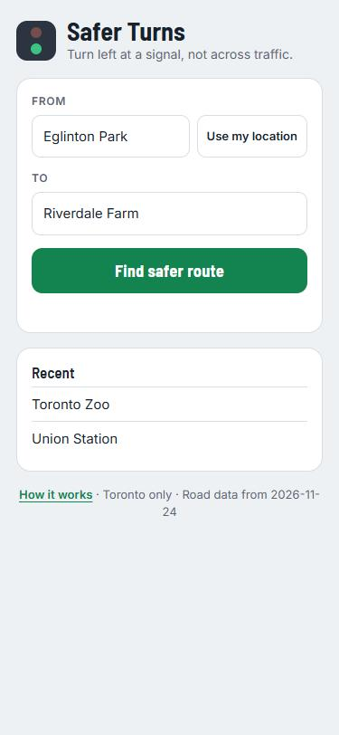<br><sub>Plan a trip</sub></td><td align="center" width="33%">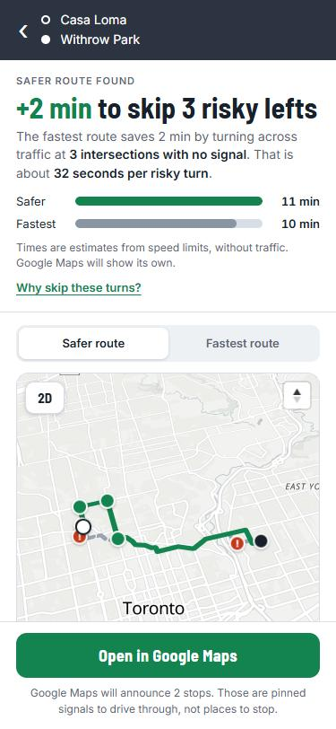<br><sub>Safer route found</sub></td><td align="center" width="33%">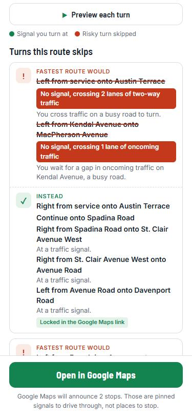<br><sub>Turns the route skips, with reasons</sub></td></tr>
<tr><td align="center" width="33%">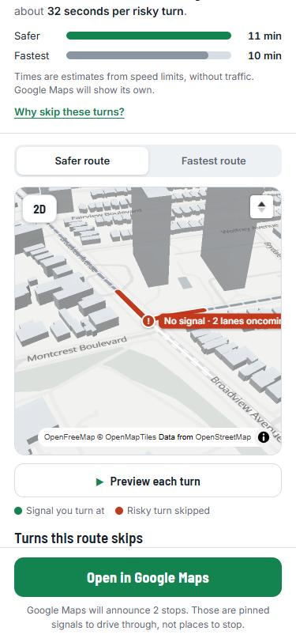<br><sub>3D map: a skipped turn in red</sub></td><td align="center" width="33%">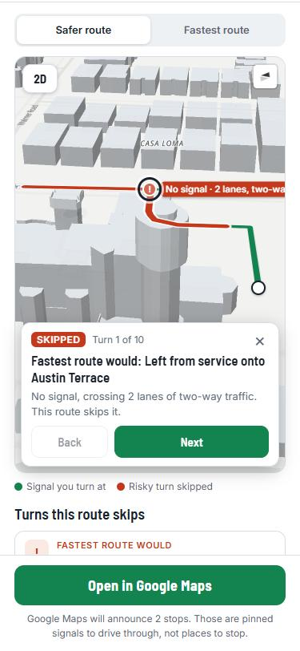<br><sub>Turn preview: a skipped turn</sub></td><td align="center" width="33%">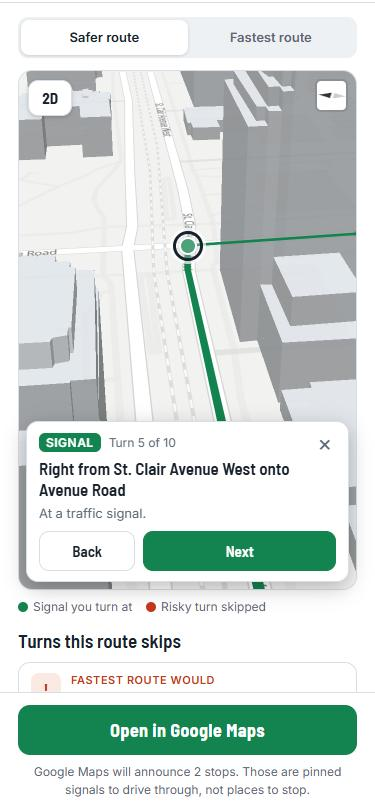<br><sub>Turn preview: turning at a signal</sub></td></tr>
<tr><td align="center" width="33%">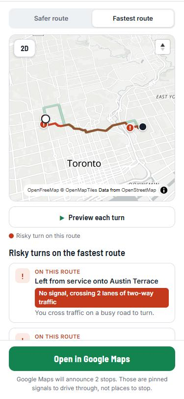<br><sub>Fastest route and its risky turns</sub></td><td align="center" width="33%">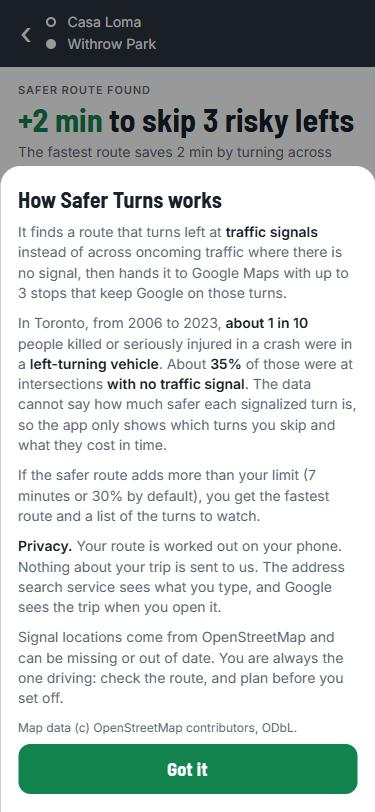<br><sub>How it works</sub></td><td align="center" width="33%">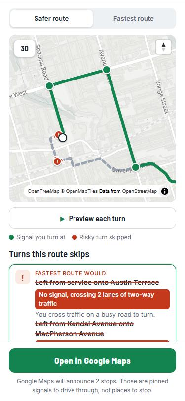<br><sub>Flat 2D map</sub></td></tr>
<tr><td align="center" width="33%">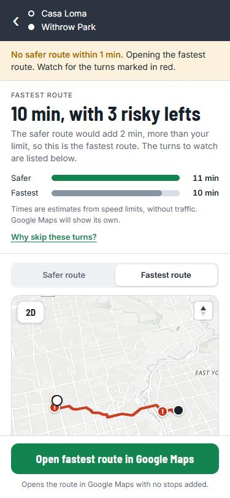<br><sub>Safer route too long: fastest route</sub></td><td align="center" width="33%">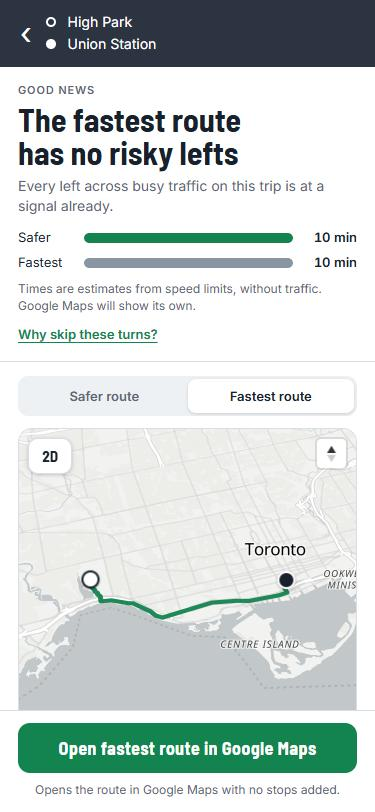<br><sub>Fastest route is already safe</sub></td><td align="center" width="33%">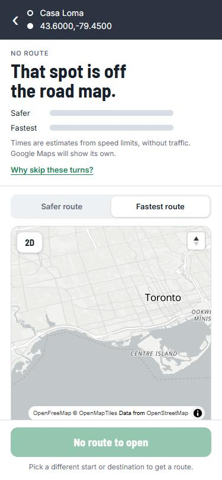<br><sub>No route</sub></td></tr>
<tr><td align="center" width="33%">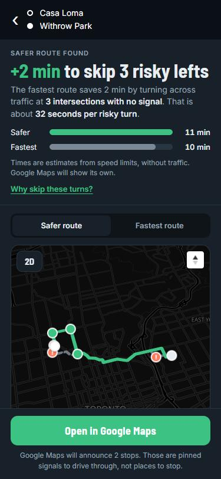<br><sub>Dark mode</sub></td><td align="center" width="33%">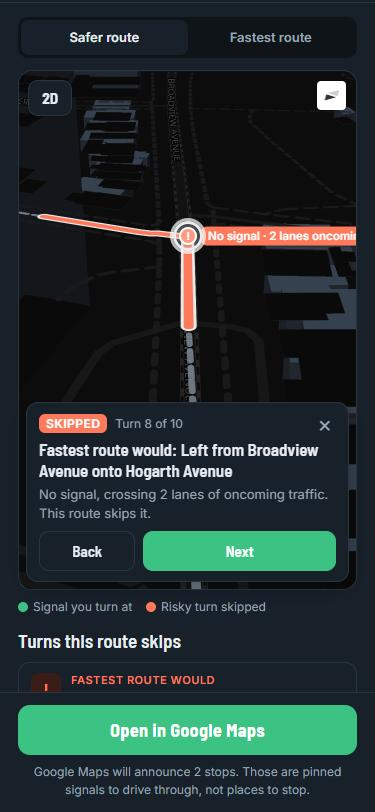<br><sub>Turn preview in dark mode</sub></td></tr>
</table>

## Run it on your PC (Windows)

1. Install Python 3 from python.org if you don't have it (tick "Add python.exe to PATH").
2. Double-click `run.bat`.
   - The first run downloads Toronto roads and traffic signals from OpenStreetMap and builds
     `web/roads/toronto.json`. That takes about 5 to 15 minutes.
   - Then it opens http://localhost:8765 in your browser.
3. To try it on your phone, join the same Wi-Fi and open `http://<your PC's IP>:8765`.
   Windows may ask to allow Python through the firewall. "Use my location" only works on
   the PC or on a published (https) site, so type the start address on the phone.

To refresh the map data, delete `web/roads/toronto.json` and run `run.bat` again.
Road files built before the 3D map have no lane counts: the app still works, but risky turns
then say "crossing two-way traffic" instead of "crossing 4 lanes of two-way traffic".
Rebuilding reuses the downloaded tiles in `osm_tiles/`, so it takes about a minute.
To merge the City of Toronto signal list: `python build_roads.py --signals-csv signals.csv`.

## Address search

By default it uses Photon, komoot's free public server (light use only). To use Geoapify,
paste your key into `web/config.js`. You can also type coordinates as `43.6629,-79.3957`.

## The map

The map is MapLibre GL with free OpenFreeMap tiles (no key, no account). It picks one of three modes:

- **3D**: tilted, with 3D buildings, and the turn preview flies the camera through each turn.
- **2D**: flat and north-up, no buildings, quick moves. Phones with 2 or fewer CPU cores or
  2 GB or less memory, or with data saver on, start here. The 2D/3D button on the map switches,
  and the choice is remembered on that phone.
- **Leaflet**: phones with no WebGL get the old flat tile map.

With "reduce motion" turned on in the system settings, the preview glides between turns instead of flying.

Each skipped risky turn is painted red on the map with a short reason, such as
"No signal · 4 lanes, two-way". "Preview each turn" under the map steps through every turn of the
route shown; on the safer route each skipped turn appears just before the turn that replaces it.

## What's in here

| Path | What it is |
| --- | --- |
| `build_roads.py` | Downloads Toronto from OpenStreetMap and writes the compact road file |
| `safer_route.py` | The original prototype; the builder reuses its road and signal logic |
| `web/` | The app: `index.html`, `app.js` (wires up the page), `ui.js` (what the screens say), `router.js` (routing), `worker.js` (loads the road file), `map.js` (map drawing), `preview.js` (turn preview, map mode) |
| `web/vendor/maplibre/` | 3D map library, MapLibre GL 4.7.1 (BSD-3 licence) |
| `web/vendor/leaflet/` | Flat map for phones with no WebGL (BSD-2 licence) |
| `tests/` | Sample street grid, router test against the prototype, headless browser test |
| `.github/workflows/pages.yml` | For later: weekly data rebuild and free GitHub Pages hosting |

## Tests

```
node --test "tests/*.test.js"                           # router, screen logic, worker, turn reasons, preview and map unit tests
node --test --experimental-test-coverage "tests/*.test.js"  # the same, with a coverage table
python -m unittest discover -s tests -p "test_*.py"     # builder and prototype unit tests
python tests/py_coverage.py                             # the same, with a coverage table
node tests/test_router.js     # JS router matches the Python prototype's times
node tests/test_ui.js         # needs Playwright; checks the screens in light and dark
node tests/bench_router.js    # routing speed on the real Toronto file (after run.bat)
```

The sample street grid is checked in. To rebuild it after changing `make_sample_osm.py`
or the builder (the app's demo copy in `web/roads/` is the same file):

```
python tests/make_sample_osm.py tests/sample_osm.json
python build_roads.py --osm-file tests/sample_osm.json --out tests/sample_roads.json --area-name Sample
copy tests\sample_roads.json web\roads\sample.json
```

Map data (c) OpenStreetMap contributors, ODbL. Signal data can be missing or out of date:
the driver is always responsible for the route.
